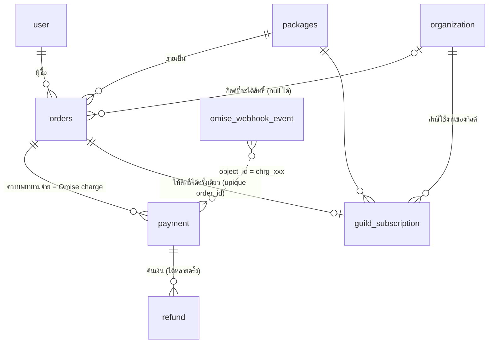

# Billing (Omise / Opn Payments)

กิลด์ซื้อ **แพ็กเกจ** เพื่อใช้งานระบบ — landing page แสดงแพ็กเกจ + ให้จ่ายผ่าน Omise
Schema อยู่ที่ `packages/db/src/schema/billing.ts` (migration `0009`–`0013`) — checkout / webhook / การบังคับสิทธิ์ ดูหัวข้อ "Checkout ในเว็บ"

## ER



| ตาราง | หน้าที่ | หมายเหตุสำคัญ |
|---|---|---|
| `packages` | สินค้าที่ขายบน landing | `code` คงที่ (slug), ราคาเป็น **สตางค์**, `durationDays` null = ตลอดไป, `limits` = สิทธิ์ที่ระบบบังคับจริง, `features` = bullet ขาย, `translations` = คำแปลต่อภาษา, `isActive`/`isPublic` ซ่อน/ปิดขาย |
| `orders` | คำสั่งซื้อ 1 แพ็กเกจ | `orderNo` อ่านง่าย (ใส่ใน description ของ charge), `packageSnapshot` = สำเนาแพ็กเกจ ณ วันซื้อ, `idempotencyKey` กันกดซ้ำ, `organizationId` null ได้ (ซื้อก่อนมีกิลด์), `billingInfo` ไว้ออกใบกำกับภาษี |
| `payment` | Omise charge (1 order : N payment) | `omiseChargeId` unique, `method` = source.type, เก็บ QR/ลิงก์จ่าย, `card` เก็บแค่ brand+last4, `rawCharge` ไว้ตรวจย้อนหลัง |
| `refund` | Omise refund | คืนบางส่วนได้หลายครั้ง (ผลรวมต้องไม่เกินยอด payment — ตรวจในโค้ด) |
| `guild_subscription` | สิทธิ์ใช้งาน (entitlement) | **unique(order_id)** = ออเดอร์เดียวให้สิทธิ์ซ้ำไม่ได้ → webhook ซ้ำปลอดภัย; ต่ออายุ = แถวใหม่ต่อท้าย `endsAt` เดิม |
| `omise_webhook_event` | กล่องรับ webhook | **unique(omise_event_id)** กันประมูลผลซ้ำ; เก็บ payload ดิบ + `processedAt`/`error` ไว้ retry |

ตารางที่ผมเพิ่มเองนอกเหนือจาก `orders`/`packages` มี 4 ตัว (`payment`, `refund`, `guild_subscription`, `omise_webhook_event`) เพราะ: 1 ออเดอร์จ่ายหลายครั้งได้ (บัตรโดนปฏิเสธแล้วลองใหม่), Omise ส่ง webhook ซ้ำและไม่รับประกันลำดับ, และ "จ่ายแล้ว" ≠ "ได้สิทธิ์" (ต้องมีตารางสิทธิ์แยกไว้ให้ระบบเช็คเร็วๆ)

## Flow ที่ออกแบบไว้

```
landing: เลือกแพ็กเกจ → login Discord → เลือก/สร้างกิลด์ → POST create-order (idempotencyKey)
  1. orders: pending (snapshot แพ็กเกจ, expiresAt = +30 นาที)
  2. เรียก Omise สร้าง charge (PromptPay: source type=promptpay → ได้ QR / บัตร: Omise.js token → 3DS redirect)
     → payment: pending (+ qrImageUri/authorizeUri)
  3. ผู้ใช้จ่าย → Omise ยิง webhook → บันทึก omise_webhook_event (ซ้ำ = ทิ้ง) → 200 ทันที
  4. ประมวลผล event: **ดึง charge ล่าสุดจาก Omise API** (ไม่เชื่อ payload) → อัปเดต payment
     → ถ้า successful: ใน transaction เดียว  orders=paid + insert guild_subscription ... on conflict (order_id) do nothing
  5. bot/job: orders ที่ pending เลย expiresAt → expired; แจ้งใกล้หมดอายุลง Discord (ใช้ scheduler เดิม)
```

**สถานะ**
- `orders`: pending → paid | failed | expired | cancelled; paid → refunded (คืนเต็ม)
- `payment`: pending → successful | failed | expired | reversed
- `guild_subscription`: active → expired (job/เช็คตอนอ่านจาก `endsAt`) | cancelled (คืนเงิน/แอดมินยกเลิก)

**เช็คสิทธิ์ของกิลด์** = มีแถว `status='active' AND starts_at <= now() AND (ends_at IS NULL OR ends_at > now())`; ค่า limit ใช้จาก `guild_subscription.limits` (สำเนา ณ วันซื้อ) ไม่ใช่จาก `packages` สด

## เรื่องความปลอดภัย / ข้อควรระวัง
- **เงินเป็นสตางค์ (integer) เสมอ** — Omise ขั้นต่ำต่อ charge ของ THB = 2000 สตางค์ (฿20)
- **ห้ามเก็บเลขบัตร/CVV**: ใช้ Omise.js tokenize ฝั่ง browser; เราเก็บ brand + last4 เท่านั้น
- **Omise webhook ไม่มี signature บังคับ** → วิธีป้องกันคือ "ดึง charge จาก API ด้วย secret key ก่อนเชื่อสถานะ" และ endpoint ต้องตอบเร็ว + idempotent
- Secret key ของ Omise (`OMISE_SECRET_KEY`) อยู่ใน `.env` ฝั่งเซิร์ฟเวอร์เท่านั้น (public key ใส่ landing ได้) — ห้าม commit
- ข้อมูลการเงินลบไม่ได้โดยไม่ตั้งใจ: FK ไป `user`/`packages`/`orders` เป็น `restrict`; ลบกิลด์แล้ว order ยังอยู่ (`organization_id` = null) แต่ subscription ของกิลด์นั้นถูกลบตาม (cascade)
- ทุก mutation สำคัญเขียน `audit_log` ต่อ (สร้าง/แก้แพ็กเกจ, คืนเงิน, ให้สิทธิ์เอง)

## Checkout ในเว็บ (implement แล้ว — ผู้ใช้ตกลงสเปก 2026-10-16)

landing อยู่ในเว็บเดียวกัน (`routes/(marketing)`) จึงใช้ session ของผู้ใช้โดยตรง ไม่ผ่าน `LANDING_API_KEY` (API `/api/orders` ยังอยู่สำหรับระบบภายนอก)

| เรื่อง | ข้อตกลง |
|---|---|
| แพ็กเกจ | อยู่ในตาราง `packages` (seed: `pnpm db:seed` → `trial` ฟรี 14 วัน, `guild-monthly` ฿299/30 วัน, `limits.maxMembers` 150) — landing render จาก DB (`(marketing)/+layout.server.ts`), คำแปลใน `translations` |
| `packages.is_trial` | ทดลองใช้: ไม่ผ่าน Omise ไม่ต้องกรอกอีเมล **1 ครั้งต่อผู้ใช้ (Discord)** — ตรวจหลัง `pg_advisory_xact_lock` ต่อผู้ใช้; `createOrder` ปฏิเสธแพ็กเกจทดลอง |
| `packages.is_featured` | ป้าย "ยอดนิยม" บน landing |
| ทางเข้า | ปุ่มแพ็กเกจ → `/start/<code>` (ต้อง login; `requireUser` พาไป `/login?next=` แล้วกลับมา) → ทดลอง: ฟอร์มสร้างกิลด์ / ต้องจ่าย: `/checkout/<code>` |
| หน้า checkout | เลือก "สร้างกิลด์ใหม่" หรือ "ต่ออายุกิลด์ที่ฉันเป็น owner" (`?guild=` เลือกไว้ให้), **อีเมลรับใบเสร็จบังคับ** (เติมอีเมลล่าสุด/Discord), ช่องทางจาก Omise Capability API กรองด้วย `lib/payment-methods.ts` |
| สร้าง charge | ฝั่งเซิร์ฟเวอร์เท่านั้น (`lib/server/checkout.ts` `startPayment` → `createOrder` + `createCharge`); บัตร: Omise.js แปลงเป็น token ใน browser (ช่องบัตรไม่มี `name` ไม่ถูกส่งมาเซิร์ฟเวอร์); ผลลัพธ์มี QR → แสดงในหน้า, มี `authorize_uri` → พาไปธนาคาร/3DS |
| หน้าสถานะ | `/checkout/order/<id>` (= `return_uri`) poll ทุก 3 วิ และดึง charge ล่าสุดจาก Omise เองด้วย (ไม่ต้องรอ webhook) |
| สร้างกิลด์หลังจ่าย | `claimOrder`: ล็อกแถวออเดอร์, ต้องเป็นผู้ซื้อ, ออเดอร์ `paid` และ `granted_at` ว่าง → สร้างกิลด์ (`billing_exempt=false`) + ให้สิทธิ์ |
| `orders.granted_at` | ให้สิทธิ์แล้ว — กัน claim ซ้ำแม้กิลด์ถูกลบภายหลัง |
| อีเมล | `lib/server/receipt.ts` ส่งครั้งเดียวต่อออเดอร์ (`receipt_sent_at`) หลัง `applyCharge` ได้ `paid` (webhook หรือหน้าสถานะ); ซื้อกิลด์ใหม่ → ปุ่ม `/claim?token=` (token สุ่ม เก็บแค่ SHA-256, อายุ 24 ชม., ใช้ครั้งเดียว, ต้อง login Discord คนเดียวกับผู้ซื้อ); ต่ออายุ → ปุ่มไปหน้าภาพรวม; ลิงก์ใช้ `PUBLIC_APP_URL`/`BETTER_AUTH_URL` (ไม่ใช่ origin ของ webhook) |
| ลิงก์หมดอายุ | หน้าภาพรวมมีแบนเนอร์ "จ่ายแล้วแต่ยังไม่ได้สร้างกิลด์" (`unclaimedOrders`) |

### สิทธิ์ใช้งาน (entitlement) — `packages/db/src/entitlement.ts` (เว็บ + บอทใช้ร่วม)
- `guild_profile.billing_exempt = true` → ใช้ได้ไม่จำกัด: กิลด์ที่ Super Admin สร้าง, กิลด์ที่มีก่อนระบบ billing (migration `0011`), Super Admin สลับได้ที่หน้า Admin (ไอคอน ∞)
- ไม่ exempt → ต้องมี `guild_subscription` active ที่ `starts_at <= now < ends_at`
- หมดอายุ: `requireGuild` (และหน้าภาพรวม) พาไป `/billing` — ข้อมูลไม่ลบ, owner เห็นปุ่มต่ออายุ, สมาชิกเห็น "ติดต่อหัวกิลด์"; Super Admin ผ่านเสมอ; บอทหยุดเตือน event ของกิลด์นั้น (`guildActiveSql` ใน scheduler)
- `limits.maxMembers` บังคับตอนเพิ่มตัวละคร (`error.memberLimit`)

### เตือนใกล้หมดอายุ — `lib/server/billing-reminders.ts`
บอทเรียก `POST /api/internal/billing-reminders` ทุกนาที (Bearer `RENDER_SECRET`): ดูแถวสิทธิ์ที่หมดช้าสุดของแต่ละกิลด์ → เหลือ ≤ 3 วัน / ≤ 1 วัน ส่ง Discord (job `billing_reminder` → ห้องแจ้งเตือน) + อีเมลล่าสุดที่ใช้ซื้อให้กิลด์นั้น (ทดลองใช้ = Discord อย่างเดียว); กันซ้ำด้วย `guild_subscription.remind_3d_sent_at` / `remind_1d_sent_at`

### ยังไม่ทำ
ตัดบัตรต่ออายุอัตโนมัติ (แสดง "เร็วๆ นี้" ในแพ็กเกจ), หน้า Admin จัดการแพ็กเกจ/ออเดอร์/คืนเงิน/ให้วันใช้งานเอง, ใบกำกับภาษี, job ตั้งออเดอร์ค้างเป็น expired, ช่องทางที่ต้องกรอกข้อมูลเพิ่ม (ผ่อน/direct debit/Atome/บาร์โค้ด)

---

# API (implement แล้ว)

โค้ด: `apps/web/src/routes/api/{orders,packages,webhooks/omise}` + `apps/web/src/lib/server/{billing,omise}.ts`
ทดสอบแล้ว 71 เคสกับ Omise API จำลอง (ไฟล์ทดสอบไม่ได้อยู่ใน repo)

## Env

| ตัวแปร | ใช้ทำอะไร |
|---|---|
| `LANDING_API_KEY` | secret ที่ landing (ฝั่งเซิร์ฟเวอร์) ส่งเป็น `Authorization: Bearer ...` สุ่มยาว ≥ 16 ตัวอักษร (สั้นกว่านี้/ไม่ตั้ง = endpoint ปิด) |
| `OMISE_SECRET_KEY` | เว็บนี้ใช้ดึง charge ไปตรวจสถานะ — **ต้องเป็น Omise account เดียวกับที่ landing ใช้สร้าง charge** |
| `OMISE_WEBHOOK_TOKEN` | (แนะนำ) ต้องใส่ `?token=` ต่อท้าย URL webhook ที่ตั้งใน Omise dashboard — Omise ไม่มี signature |
| `OMISE_API_BASE` | ไม่ต้องตั้ง (ใช้เทสต์กับ Omise ปลอม) |

## `GET /api/packages` (สาธารณะ ไม่ต้องมี key, เปิด CORS)
คืนแพ็กเกจที่เปิดขาย (`isActive`) และไม่ซ่อน (`isPublic`) เรียงตาม `sortOrder` แล้วตามราคา
```json
{ "packages": [ { "code": "pro-monthly", "name": "Pro Monthly", "description": null, "translations": null,
  "priceSatang": 9900, "currency": "THB", "durationDays": 30, "features": ["..."] } ] }
```

## `POST /api/orders` (landing → เว็บ นี้) — สร้างออเดอร์
`Authorization: Bearer $LANDING_API_KEY`, `Content-Type: application/json`
```json
{ "packageCode": "pro-monthly",
  "discordId": "123456789012345678",
  "organizationId": "…(ไม่บังคับ)",
  "idempotencyKey": "uuid-ต่อการกดซื้อหนึ่งครั้ง",
  "billingInfo": { "name": "…", "taxId": "…", "address": "…", "email": "…" } }
```
- `discordId` = ผู้ซื้อ — **ต้องเคย login เว็บนี้ด้วย Discord แล้ว** ไม่งั้น `404 user_not_found` (landing ควรพาไป login ก่อน)
- `organizationId` ถ้าใส่ ผู้ซื้อต้องเป็น **owner** ของกิลด์นั้น (`403 not_guild_owner`); ไม่ใส่ = ซื้อก่อนมีกิลด์ (ออเดอร์จ่ายได้ แต่สิทธิ์จะยังไม่ถูกสร้างจนกว่าจะผูกกิลด์ — **ส่วนผูกกิลด์ยังไม่ได้ทำ**)
- ส่ง `idempotencyKey` เดิมซ้ำ → `200` ได้ออเดอร์เดิม (`reused: true`); key เดิมแต่คนละแพ็กเกจ/กิลด์ → `409 idempotency_conflict`

ตอบ `201`:
```json
{ "order": { "id": "…", "orderNo": "ROW-261016-7K3QWD", "status": "pending", "amountSatang": 9900, "currency": "THB",
             "expiresAt": "…(+30 นาที)", "organizationId": null, "package": { "code": "pro-monthly", "name": "…", "durationDays": 30 } },
  "requiresPayment": true, "reused": false,
  "charge": { "amount": 9900, "currency": "thb", "description": "ROW-261016-7K3QWD Pro Monthly",
              "metadata": { "order_id": "…", "order_no": "ROW-261016-7K3QWD", "organization_id": null } } }
```
**landing ต้องสร้าง Omise charge ด้วยค่าใน `charge` เป๊ะๆ** (โดยเฉพาะ `amount`, `currency` และ `metadata.order_id` — webhook ใช้ผูกการจ่ายกับออเดอร์; ถ้ายอด/สกุลเงินไม่ตรง ระบบจะ **ไม่ให้สิทธิ์** และบันทึกเตือนไว้):
```js
// ฝั่งเซิร์ฟเวอร์ของ landing (Node, omise package) — ตัวอย่าง PromptPay
const charge = await omise.charges.create({
  ...orderResponse.charge,                       // amount, currency, description, metadata
  source: { type: 'promptpay' },                 // หรือ card: omiseToken จาก Omise.js
  return_uri: 'https://landing.example/thanks'   // ใช้กับวิธีที่ redirect
});
// แสดง charge.source.scannable_code.image.download_uri (QR) ให้ผู้ใช้สแกน
```
- แพ็กเกจราคา 0: ตอบ `status: "paid"`, `requiresPayment: false`, `charge: null` และให้สิทธิ์ทันที (ไม่ต้องสร้าง charge)
- Error รูปแบบ `{ "error": "<code>" }`: `unauthorized 401`, `invalid_json/invalid_request/…400`, `user_not_found 404`, `package_not_found 404`, `organization_not_found 404`, `not_guild_owner 403`, `idempotency_conflict 409`

## `GET /api/orders/:id` (landing → เว็บนี้) — ถามสถานะ (ใช้ polling หลังผู้ใช้จ่าย)
คืน `order.status`, รายการ `payments[]` (charge id/วิธีจ่าย/สถานะ/failureCode) และ `subscription` (`startsAt`/`endsAt`) ถ้ามี
`status` ที่ต้องดู: `pending` → รอ, `paid` → สำเร็จ, `failed`/`expired` → ให้ผู้ใช้ลองใหม่ (landing สร้าง charge ใหม่กับ order เดิมได้ตราบที่ยังไม่ paid/refunded), `refunded`

## `POST /api/webhooks/omise` (Omise → เว็บนี้)
ตั้งใน Omise dashboard → Webhooks: `https://<โดเมนเว็บ>/api/webhooks/omise?token=<OMISE_WEBHOOK_TOKEN>` เลือก event `charge.*` และ `refund.*` (ชนิดอื่นรับแล้วข้ามให้)
1. ตรวจ token → บันทึก event ลง `omise_webhook_event` (unique `evnt_id` — ซ้ำที่ประมวลผลแล้วตอบ `duplicate`)
2. **ดึง charge ล่าสุดจาก Omise API** (ไม่เชื่อ payload) แล้วหาออเดอร์จาก `metadata.order_id` → upsert `payment`
3. `successful` + ยอด/สกุลตรง → ออเดอร์ `paid` + สร้าง `guild_subscription` (transaction + ล็อกแถวออเดอร์; `unique(order_id)` กันให้สิทธิ์ซ้ำ; ต่ออายุต่อท้ายสิทธิ์ที่ยังเหลือ)
4. `failed/expired/reversed` → ออเดอร์ `failed/expired` เมื่อไม่มีความพยายามจ่ายอื่นที่ใช้ได้เหลืออยู่
5. คืนเงิน → บันทึก `refund`; คืนเต็มจำนวน → ออเดอร์ `refunded` + สิทธิ์ `cancelled`

ตอบ `200` เมื่อรับทราบ (รวมซ้ำ/ไม่เกี่ยวข้อง/charge ที่ไม่ใช่ของระบบเรา), `500` เมื่อพังชั่วคราว (เช่นเรียก Omise ไม่ได้) เพื่อให้ Omise ส่งซ้ำ — event ที่พังจะถูกประมวลผลใหม่เมื่อส่งซ้ำ
**ความผิดปกติที่ต้องให้คนตรวจ** จะอยู่ใน `omise_webhook_event.error`: ยอด/สกุลเงินไม่ตรง, จ่ายซ้ำออเดอร์ที่จ่ายแล้ว (ต้องคืนเงิน), จ่ายแล้วแต่ออเดอร์ไม่มีกิลด์, charge ของออเดอร์ที่คืนเงินไปแล้ว
เงินที่เข้าหลังออเดอร์หมดเวลา **ยังให้สิทธิ์** (เงินเข้าจริงแล้ว)

## ที่ยังไม่ได้ทำ
ผูกกิลด์ให้ออเดอร์ที่จ่ายแล้วแต่ยังไม่มีกิลด์ (และสร้างสิทธิ์ตอนนั้น), job ตั้งออเดอร์หมดเวลา/สิทธิ์หมดอายุ/เตือนผ่าน Discord, ตัวบังคับ `limits`, หน้า Admin (แพ็กเกจ/ออเดอร์/คืนเงิน), ค่าธรรมเนียม Omise (`payment.fee_satang` ยังเป็น null)
