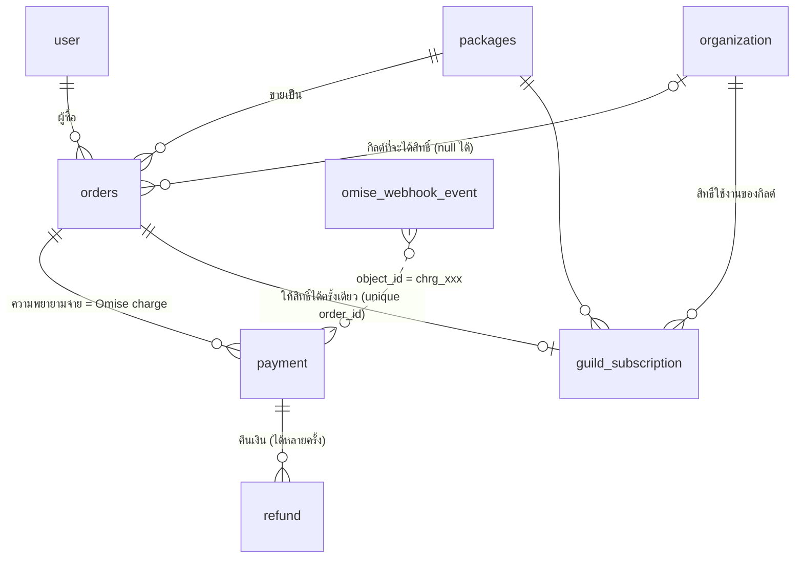

# Billing (Omise / Opn Payments)

กิลด์ซื้อ **แพ็กเกจ** เพื่อใช้งานระบบ — landing page แสดงแพ็กเกจ + ให้จ่ายผ่าน Omise
Schema อยู่ที่ `packages/db/src/schema/billing.ts` (migration `0009`) ตอนนี้มี **เฉพาะตารางข้อมูล** ยังไม่มี checkout / webhook / การบังคับสิทธิ์

## ER



| ตาราง | หน้าที่ | หมายเหตุสำคัญ |
|---|---|---|
| `packages` | สินค้าที่ขายบน landing | `code` คงที่ (slug), ราคาเป็น **สตางค์**, `durationDays` null = ตลอดไป, `limits` = สิทธิ์ที่ระบบบังคับจริง, `features` = bullet ขาย, `translations` = คำแปลต่อภาษา, `isActive`/`isPublic` ซ่อน/ปิดขาย |
| `orders` | คำสั่งซื้อ 1 แพ็กเกจ | `orderNo` อ่านง่าย (ใส่ใน description ของ charge), `packageSnapshot` = สำเนาแพ็กเกจ ณ วันซื้อ, `idempotencyKey` กันกดซ้ำ, `organizationId` null ได้ (ซื้อก่อนมีกิลด์), `billingInfo` ไว้ออกใบกำกับภาษี |
| `payment` | Omise charge (1 order : N payment) | `omiseChargeId` unique, `method` = source.type, เก็บ QR/ลิงก์จ่าย, `card` เก็บแค่ brand+last4, `rawCharge` ไว้ตรวจย้อนหลัง |
| `refund` | Omise refund | คืนบางส่วนได้หลายครั้ง (ผลรวมต้องไม่เกินยอด payment — ตรวจในโค้ด) |
| `guild_subscription` | สิทธิ์ใช้งาน (entitlement) | **unique(order_id)** = ออเดอร์เดียวให้สิทธิ์ซ้ำไม่ได้ → webhook ซ้ำปลอดภัย; ต่ออายุ = แถวใหม่ต่อท้าย `endsAt` เดิม |
| `omise_webhook_event` | กล่องรับ webhook | **unique(omise_event_id)** กันประมูลผลซ้ำ; เก็บ payload ดิบ + `processedAt`/`error` ไว้ retry |

ตารางที่ผมเพิ่มเองนอกเหนือจาก `orders`/`packages` มี 4 ตัว (`payment`, `refund`, `guild_subscription`, `omise_webhook_event`) เพราะ: 1 ออเดอร์จ่ายหลายครั้งได้ (บัตรโดนปฏิเสธแล้วลองใหม่), Omise ส่ง webhook ซ้ำและไม่รับประกันลำดับ, และ "จ่ายแล้ว" ≠ "ได้สิทธิ์" (ต้องมีตารางสิทธิ์แยกไว้ให้ระบบเช็คเร็วๆ)

## Flow ที่ออกแบบไว้

```
landing: เลือกแพ็กเกจ → login Discord → เลือก/สร้างกิลด์ → POST create-order (idempotencyKey)
  1. orders: pending (snapshot แพ็กเกจ, expiresAt = +30 นาที)
  2. เรียก Omise สร้าง charge (PromptPay: source type=promptpay → ได้ QR / บัตร: Omise.js token → 3DS redirect)
     → payment: pending (+ qrImageUri/authorizeUri)
  3. ผู้ใช้จ่าย → Omise ยิง webhook → บันทึก omise_webhook_event (ซ้ำ = ทิ้ง) → 200 ทันที
  4. ประมวลผล event: **ดึง charge ล่าสุดจาก Omise API** (ไม่เชื่อ payload) → อัปเดต payment
     → ถ้า successful: ใน transaction เดียว  orders=paid + insert guild_subscription ... on conflict (order_id) do nothing
  5. bot/job: orders ที่ pending เลย expiresAt → expired; แจ้งใกล้หมดอายุลง Discord (ใช้ scheduler เดิม)
```

**สถานะ**
- `orders`: pending → paid | failed | expired | cancelled; paid → refunded (คืนเต็ม)
- `payment`: pending → successful | failed | expired | reversed
- `guild_subscription`: active → expired (job/เช็คตอนอ่านจาก `endsAt`) | cancelled (คืนเงิน/แอดมินยกเลิก)

**เช็คสิทธิ์ของกิลด์** = มีแถว `status='active' AND starts_at <= now() AND (ends_at IS NULL OR ends_at > now())`; ค่า limit ใช้จาก `guild_subscription.limits` (สำเนา ณ วันซื้อ) ไม่ใช่จาก `packages` สด

## เรื่องความปลอดภัย / ข้อควรระวัง
- **เงินเป็นสตางค์ (integer) เสมอ** — Omise ขั้นต่ำต่อ charge ของ THB = 2000 สตางค์ (฿20)
- **ห้ามเก็บเลขบัตร/CVV**: ใช้ Omise.js tokenize ฝั่ง browser; เราเก็บ brand + last4 เท่านั้น
- **Omise webhook ไม่มี signature บังคับ** → วิธีป้องกันคือ "ดึง charge จาก API ด้วย secret key ก่อนเชื่อสถานะ" และ endpoint ต้องตอบเร็ว + idempotent
- Secret key ของ Omise (`OMISE_SECRET_KEY`) อยู่ใน `.env` ฝั่งเซิร์ฟเวอร์เท่านั้น (public key ใส่ landing ได้) — ห้าม commit
- ข้อมูลการเงินลบไม่ได้โดยไม่ตั้งใจ: FK ไป `user`/`packages`/`orders` เป็น `restrict`; ลบกิลด์แล้ว order ยังอยู่ (`organization_id` = null) แต่ subscription ของกิลด์นั้นถูกลบตาม (cascade)
- ทุก mutation สำคัญเขียน `audit_log` ต่อ (สร้าง/แก้แพ็กเกจ, คืนเงิน, ให้สิทธิ์เอง)

## เรื่องที่ต้องคุยก่อนทำ checkout
1. **ใครสร้างกิลด์?** ตอนนี้สร้างกิลด์ได้เฉพาะ Super Admin (หน้า Admin) — ถ้าให้คนซื้อแล้วใช้เลย ต้องมี "สร้างกิลด์เอง" หลังจ่าย (ผม model `orders.organization_id` เป็น nullable รองรับไว้แล้ว)
2. **ต่ออายุอัตโนมัติ หรือซื้อซ้ำเอง?** PromptPay ตัดซ้ำอัตโนมัติไม่ได้ (บัตรทำได้ผ่าน Omise Schedule/Customer แต่ยังไม่ได้ออกแบบ) — ตอนนี้ออกแบบเป็น "จ่ายล่วงหน้าทีละรอบ + บอทเตือนใกล้หมดอายุ"
3. **กิลด์ที่หมดอายุ** ทำอะไร? (อ่านอย่างเดียว / ล็อกทั้งหมด / ลดเหลือแพ็กเกจฟรี) — ตัดสินใจก่อนเขียนตัวบังคับสิทธิ์
4. **มีแพ็กเกจฟรี/ทดลองใช้ไหม?** ถ้ามี `packages.priceSatang = 0` ได้ (order amount 0 ข้าม Omise ไม่สร้าง payment)
5. **ใบกำกับภาษี/ใบเสร็จ** ต้องออกไหม (ตอนนี้มีแค่ `billingInfo` เก็บชื่อ/เลขผู้เสียภาษี/ที่อยู่ ยังไม่มีเลขที่ใบกำกับ)
6. **ส่วนลด/โค้ด** — ยังไม่ได้ทำตาราง (เพิ่ม `coupon` + `orders.discountSatang` ได้ทีหลังโดยไม่กระทบตารางเดิม)
7. **landing อ่านแพ็กเกจยังไง** — อ่าน DB ผ่าน `@row/db` ตรงๆ หรือเรียก `GET /api/packages` ของเว็บ (แนะนำแบบหลัง: landing ไม่ต้องถือ `DATABASE_URL`)

## สิ่งที่ยังไม่ได้ทำ (ตั้งใจ)
หน้า Admin จัดการแพ็กเกจ/ออเดอร์, endpoint สร้างออเดอร์/webhook, ตัวบังคับ limits ในระบบ, job หมดอายุ/เตือน, seed แพ็กเกจ (ยังไม่ทราบราคา/สิทธิ์จริง)
