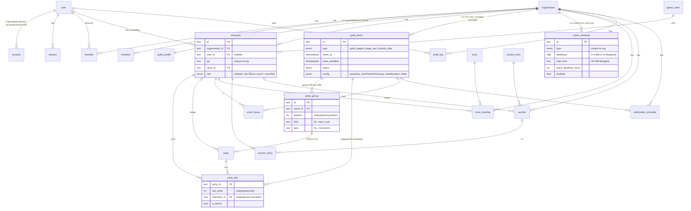

# ER Diagram

ตารางสีเทา `user / session / account / verification / organization / member / invitation` สร้างโดย Better Auth CLI
(`pnpm auth:generate` → `packages/db/src/schema/auth.ts`) **ห้ามแก้มือ** ที่เหลืออยู่ใน `packages/db/src/schema/*.ts`

## Unique index ที่กันข้อมูลชน (ข้อ 8 ใน CLAUDE.md)

| ตาราง | Unique | กันอะไร |
|---|---|---|
| `character` | `(organization_id, ign)` | ชื่อตัวละครซ้ำในกิลด์ |
| `guild_event` | `(organization_id, type)` | event ถาวรประเภทละ 1 อัน |
| `party_group` | `(event_id, position)` | ลำดับ group ซ้ำ |
| `party` | `(group_id, position)` | ลำดับปาร์ตี้ซ้ำใน group |
| `party_slot` | `(party_id, slot_index)` | slot ซ้ำ |
| `party_slot` | `(event_id, character_id)` | ตัวละครเดียวอยู่สองปาร์ตี้ใน event เดียว |
| `event_leave` | `(event_id, character_id)` | ลาซ้ำ |
| `boss_booking` | `(organization_id, boss_id, slot_start)` | จองบอสชน |
| `auction_entry` | `(auction_id, character_id)` | ลงคิวซ้ำ |
| `game_class`, `boss`, `auction_item` | `name` | master data ซ้ำ |

## ข้อสังเกต

- `id` ทุกตารางเป็น `text` (UUID) ให้เข้ากับ Better Auth
- เวลาทุกคอลัมน์เป็น `timestamptz` (UTC) แสดงผลเป็น `Asia/Bangkok` ที่ UI
- ขนาด: กิลด์ 150 คน, ปาร์ตี้ละ 5 คน, group ละ ≤8 ปาร์ตี้ (40 คน) — `guild_event.config` (jsonb) ตั้งค่าได้ ค่าเริ่มต้นต่อประเภทอยู่ที่ `EVENT_PRESETS` ใน `@row/shared`
  - Guild League: 2 สนาม (`party_group.field` = main 60 คน / sub ที่เหลือ ~90 คน), main แบ่ง 3 group ตามเลน บน/กลาง/ล่าง
  - Siege War: สร้าง group กี่อันก็ได้ ไม่จำกัด
  - Polarity: จำกัด 50 คน (10 ปาร์ตี้แบบแบน — ใช้ party_group ซ่อน 1 อัน UI ไม่แสดง group)
- เพดานจำนวนคน/ปาร์ตี้/group ต้องเช็คใน server code (DB บังคับเฉพาะ unique)
- `auction_entry.priority` เป็นช่อง generic — จาก Google Sheet คิวประมูลดูเป็นรายการเรียงต่อไอเทม (q1, q2, …) รอยืนยันกติกาก่อนทำ Phase 4
- ยังไม่มีตาราง: Party Template, Announcement, Activity Tracker, Discord ID ↔ ชื่อ sync (P2)
- `party_slot.event_id` เก็บซ้ำโดยตั้งใจ เพื่อให้ unique ระดับ DB ทำงาน; ต้องให้ตรงกับ `party.event_id` เสมอ (บังคับใน server code)
